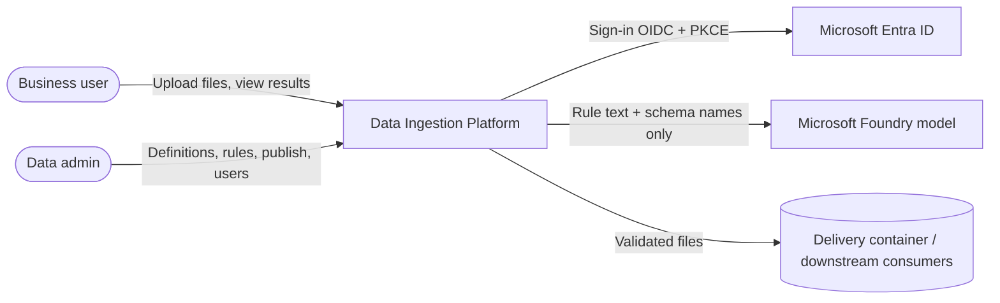
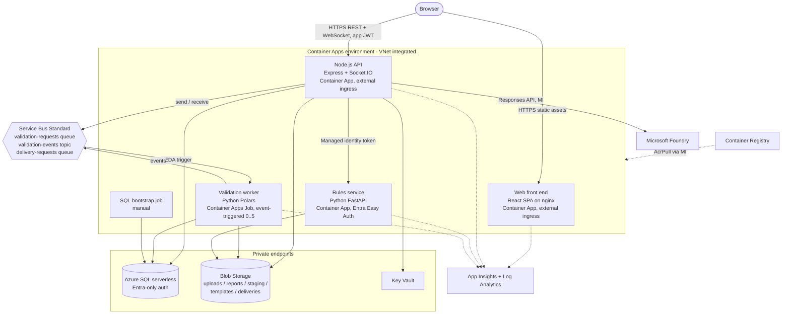
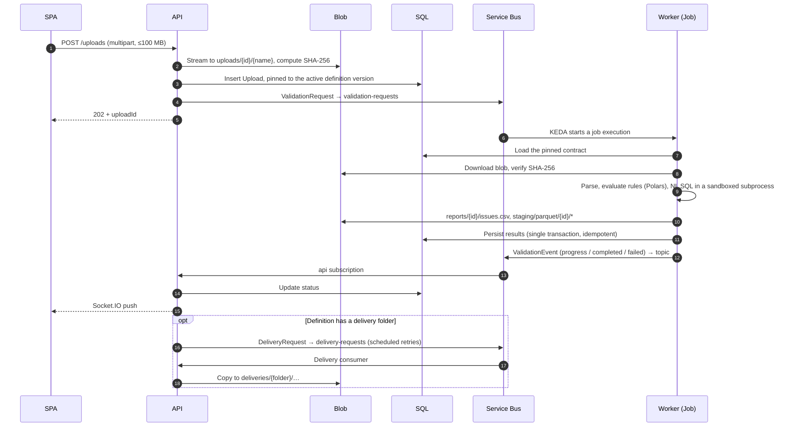
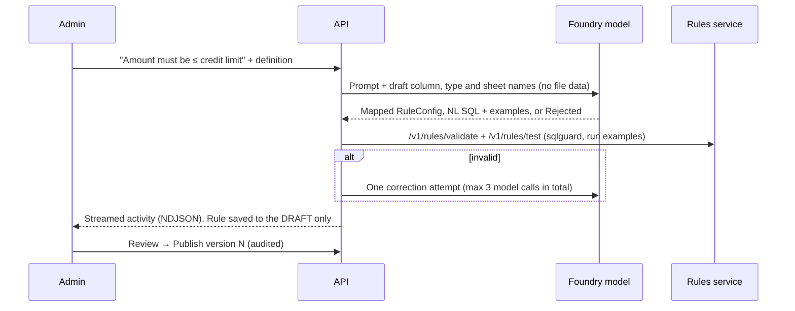
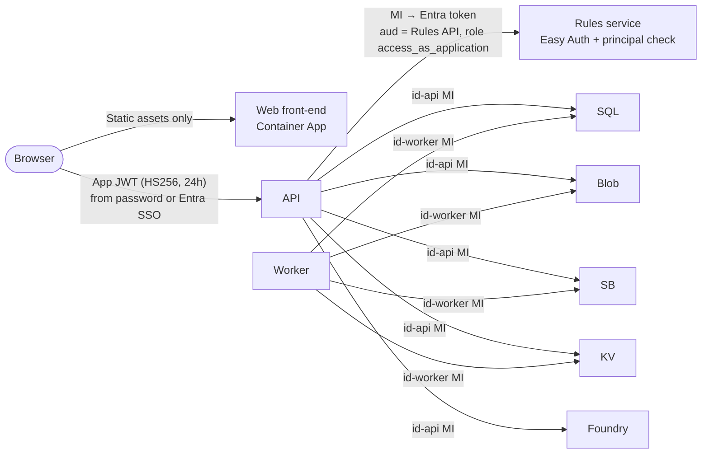

# Data Ingestion Platform: Architecture Overview

**For:** Architecture Review Board · **Status:** Pre-production. Infrastructure is defined in Bicep/azd. The target region is **France Central**. Nothing is deployed yet (see [deployment.md](deployment.md)).

> **Hosting change:** the web front end now runs on **Azure Container Apps** instead of Azure Static Web Apps. Static Web Apps isn't offered in France Central, and Container Apps puts every tier on one platform. The Bicep templates, `azd` configuration, hooks and [deployment.md](deployment.md) have been updated for the change (still uncommitted).

## 1. Summary

Business users upload CSV, TSV, TXT and Excel files against a governed **file definition**. A definition contains versioned tables, columns and rules. Each file is validated asynchronously by a Python/Polars engine. Users receive per-rule results and an issues report. If the definition requests it, the file is then delivered to a downstream location. Admins can write rules in plain language. Microsoft Foundry turns the text into a declarative rule or restricted SQL. Every proposal is validated and tested before it is saved, and it applies to uploads only after an admin publishes it.

**Recommended approach:** an Azure-native, event-driven design. A stateless web/API tier is decoupled through Service Bus from scale-to-zero validation workers. Data-plane access uses managed identities, and data services sit behind private endpoints.

## 2. Context

## 3. Logical architecture (Azure target)

| Component | Technology | Responsibility |
|---|---|---|
| Front-End | React 19 + Vite 7 on unprivileged nginx (port 8080), in a Container App that scales 0–2 | User and admin UI, live status over Socket.IO. A stateless static container; the API URL is injected when the container starts |
| API (`Back-End`) | Node 24, Express, TypeScript | Authentication and RBAC, definitions, versioning and audit, upload intake, orchestration, delivery, NL rule authoring |
| Rules service (`Validation-Service`) | Python 3.12, FastAPI | Synchronous rule compile/test, contract validation, dry run, example-file analysis |
| Validation worker (same image) | Python, Polars, PyArrow, sqlglot | Parses files, evaluates rules, writes reports and Parquet, persists results |
| Contracts (`contracts/`) | JSON Schema | Single source for RuleConfig, the definition contract and message schemas. TypeScript and Pydantic types are generated from it |
| Data | Azure SQL, Blob Storage | Metadata and results (SQL); files and artifacts (Blob) |
| Messaging | Service Bus | Decouples intake, validation and delivery; provides retries and dead-lettering |

## 4. Key flows

### 4.1 Upload → validate → deliver

**Upload states:** `UPLOADED → VALIDATION_QUEUED → VALIDATION_IN_PROGRESS → VALIDATION_PASSED | VALIDATION_FAILED`. A passed upload then becomes `VALIDATED` (no delivery) or moves `DELIVERY_IN_PROGRESS → DELIVERED | DELIVERY_FAILED`. Transitions use compare-and-set in SQL, so duplicate or out-of-order events are ignored.

### 4.2 Natural-language rule authoring

**Guardrails:**
- The model output must be a schema-valid RuleConfig. It is never executed as code.
- `sqlguard` parses the SQL with sqlglot and checks it against allow-lists. Only declared columns and approved functions are permitted. Files, DDL/DML and non-deterministic functions are blocked.
- SQL runs in a spawned subprocess with a 30-second timeout.
- An admin must publish a rule before it applies to uploads.

## 5. Data architecture

| Store | Content | Notes |
|---|---|---|
| SQL `FileDefinitions`, `FileDefinitionVersions`, `Rules` | Draft and immutable published contracts, with rules as JSON | Each upload is pinned to a version, so results are reproducible |
| SQL `Uploads`, `UploadSheets`, `ValidationResults`, `ValidationRuleDetails`, `DeliveryRecords` | Status, counts, ≤100 sample issues per rule | Cell values are stored only in samples |
| SQL `Users`, `FileDefinitionUserAccess`, `UploadAccess`, `AuditLogs` | RBAC and the audit trail | Publish and admin actions are audited |
| Blob `uploads` | Raw customer files | Private; access via MI only |
| Blob `reports`, `staging` | issues.csv; Parquet (zstd) per table | `staging` is deleted after 30 days by a lifecycle rule |
| Blob `deliveries` | Delivered outputs | Deterministic names make replays idempotent; 7-day soft delete |

## 6. Security and identity

- **Identity:**
  - Separate user-assigned identities for the API, the worker and the SQL bootstrap job.
  - The front end has its own identity with `AcrPull` only. It holds no secrets and has no access to application data.
  - RBAC is scoped to individual Blob containers and Service Bus entities.
  - SQL uses Entra-only authentication with contained users (`db_datareader`/`db_datawriter`).
  - Service Bus local/SAS authentication is disabled, and the ACR admin user is disabled.
- **Secrets:** Only the JWT signing key, the SSO client secret and the App Insights connection string are stored, all in Key Vault and read by Container Apps through MI. There are no connection strings in Azure. Local `.env` files are git-ignored.
- **User authentication:**
  - Entra SSO uses the authorization code flow with PKCE and server-side ID token validation. App-local password login is also supported.
  - The API then issues its own JWT. Roles are `admin` and `user`, with per-definition access grants.
  - Socket.IO uses the same token and is filtered per upload.
- **Input hardening:**
  - Extension and MIME allow-list, 100 MB size cap, sanitized file names and path-traversal guards.
  - SHA-256 integrity check between intake and validation.
  - Helmet, CORS allow-list, rate limiting, and an optional token-protected `/metrics` endpoint.
- **AI data handling:**
  - Only the rule text and schema names are sent to Foundry, never file contents.
  - Full model output is logged only when debug logging is explicitly enabled.
  - No API keys; Foundry access uses `DefaultAzureCredential`.

## 7. Networking

| Resource | Exposure | Rationale |
|---|---|---|
| SQL, Blob, Key Vault | **Private endpoint only**; public access disabled | Customer data plane |
| API, web front-end Container App | Public HTTPS (Container Apps external ingress, managed TLS, HTTP disallowed) | User-facing. API CORS allows only the exact front-end origin, and the Entra callback is `<frontend>/auth/callback` |
| Rules service | Public FQDN, **Easy Auth enforced** (401 for anonymous callers; only the API MI is allowed) | Documented, owner-accepted deviation from internal ingress |
| Service Bus (Standard) | Public endpoint; Entra-only authentication and RBAC, without an IP allowlist | Standard supports IP filtering but not Private Link/service endpoints; the Consumption Container Apps environment has no reported outbound IP list. The owner chose this lower-cost network posture instead of adding NAT Gateway costs. |
| ACR (Basic), App Insights | Public, authenticated | Private Link needs a higher tier |

## 8. Reliability, scale and performance

- **Async decoupling:** Service Bus provides at-least-once delivery, lock renewal and dead-lettering of malformed requests. Worker writes are idempotent per upload.
- **Elastic validation:** KEDA scales the worker job from 0 to 5 parallel executions (2 vCPU / 4 GiB each, configurable), with a 30-minute timeout and 2 retries.
- **Measured engine performance** (dev host, not the reference 4 vCPU / 8 GiB gate):

  | Workload | Time | Peak memory |
  |---|---|---|
  | 1M-row CSV, 18 rules | ~1.2 s | ~1.1 GiB |
  | 300k-row XLSX | ~2.5 s | — |

  An NL SQL row rule adds about 17 ms. A golden suite of 110 tests confirms parity with the legacy Node engine.
- **Current constraints:** the API and rules service are each pinned to **1 replica**, because Socket.IO and the delivery consumer run in-process. There is no zone redundancy (Storage LRS, single-zone SQL), and no multi-region DR.

## 9. Observability and operations

- **Telemetry:** OpenTelemetry/App Insights traces for each validation stage (download, parse, rules, write, persist) and a rows/sec metric. Log Analytics retains data for 30 days. Prometheus metrics are exposed by the API.
- **Queue health:** queue depth and dead-letter counts are shown on the admin Monitoring page.
- **Logging policy:** no cell values, file contents, tokens or secrets in logs.
- **CI** (GitHub Actions on every PR and push to main): lint, type-check, unit tests and build for all three components. Playwright end-to-end tests and a sample corpus are available locally.
- **CD:**
  - A manual `azd deploy` workflow uses OIDC and a protected GitHub environment. Provisioning is a separate step that requires approval.
  - Images for the web front end, the API and the rules service/worker are built remotely in ACR with immutable tags.
  - The web image has no hard-coded API URL. At start, it writes `runtime-config.js` from `API_URL`, which must be HTTPS and end in `/api/v1`. One image can therefore be promoted across environments. The postprovision hook sets the API CORS origin and the SSO callback to the front-end URL.
  - Schema migrations run as an in-VNet job. The job temporarily elevates the bootstrap MI and always restores the SQL admin.
- **Local development:** run `start.ps1` with Docker Compose (SQL Server, Azurite, Service Bus emulator). No Azure dependency except Foundry for NL rules.

## 10. Cost drivers

There is no fixed estimate yet. It depends on active hours and data volumes.

- **Always-on:** API replica, rules-service replica, three private endpoints, Service Bus Standard.
- **Web front end:** 0.25 vCPU / 0.5 GiB per replica, scaling from 0 to 2 replicas. It costs almost nothing when idle; the trade-off is a cold start for the first user. Set the minimum to 1 replica in production if latency matters.
- **Usage-based:**
  - Worker vCPU-seconds.
  - SQL serverless: 0.5–2 vCores, auto-pauses after 60 minutes.
  - Log Analytics ingestion.
  - Foundry tokens: 1–3 calls per NL rule authoring session; none at upload time.

## 11. Key decisions

| # | Decision | Alternatives considered | Rationale |
|---|---|---|---|
| D1 | Python + Polars engine replacing Node validation | Keep Node; Spark/Fabric | ~1M rows/s on one node, columnar, no cluster cost; parity proven by the golden suite |
| D2 | Container Apps Jobs (event-triggered) for workers | Functions, AKS, always-on worker | Scale to zero, long runs (30 min), large memory, KEDA built in |
| D3 | Service Bus queues/topic between API and worker | Direct HTTP, Storage queues | Retries, DLQ, scheduled delivery retries, topic fan-out |
| D4 | Contract-first JSON Schema shared across TS/Python | Hand-maintained types | Prevents drift across language boundaries |
| D5 | Versioned definitions, uploads pinned to a version | Mutable definitions | Reproducibility, auditability, safe rule changes |
| D6 | LLM output limited to declarative RuleConfig or guarded SQL | LLM-generated code | Removes code-execution and prompt-injection blast radius; deterministic runtime |
| D7 | Standard tiers (Service Bus, ACR) with Entra-only public access rather than Premium + Private Link | Premium everywhere | Lower PoC recurring cost; Service Bus has broader network reach, with Entra authentication and RBAC still enforced |
| D8 | Host the web front end on Azure Container Apps | Static Web Apps (previous choice), App Service, Blob static website + Front Door | Static Web Apps isn't offered in France Central. Container Apps shares the platform, identity model, ACR, logging and `azd` pipeline with the other services, has an SLA (SWA Free has none), and allows a future same-origin proxy or private ingress. Trade-offs: no built-in global CDN, and the team must patch the nginx image |

## 12. Risks, gaps and recommendations

| Severity | Item | Recommendation (production) |
|---|---|---|
| High | API is a single replica, with Socket.IO and the delivery consumer in-process (SPOF; no horizontal scale) | Move real-time updates to **Azure Web PubSub**, split the delivery consumer into a Container Apps Job, and allow ≥2 replicas |
| High | App JWT is stored in `localStorage` (XSS exposure), uses an HS256 shared secret, lasts 24h, and cannot be revoked | Use httpOnly SameSite cookies with CSRF protection, shorter tokens with refresh, and a revocation list. Prefer Entra-only sign-in and retire local passwords |
| High | No malware scanning of uploaded files (including macro-enabled Excel types) | Enable **Defender for Storage** malware scanning on `uploads` and gate validation on a clean result |
| Medium | Rules service has a public FQDN (authenticated) | Use internal ingress with in-app bearer validation if policy requires it |
| Medium | Service Bus has a public endpoint without an IP allowlist; local/SAS authentication is disabled | If network-level restriction is required, add NAT Gateway plus a static egress IP and IP rules, or upgrade Service Bus to Premium and use Private Link; review the additional recurring cost |
| Medium | No zone redundancy or DR | ZRS/GRS storage, zone-redundant SQL, a zone-redundant Container Apps environment, and documented RPO/RTO |
| Medium | The front end sends only `nosniff` and `Referrer-Policy` headers. There is no Content-Security-Policy, frame protection or HSTS, which matters more while the token is in `localStorage` | Add CSP (`default-src 'self'`, `connect-src` limited to the API origin), `frame-ancestors 'none'` and HSTS in `nginx.conf` |
| Low | The front-end change hasn't been validated in Azure yet (runtime config, CORS, SSO callback, cold start) | Run the post-deployment checks in [deployment.md](deployment.md) after the first France Central deployment |
| Low | No CDN or WAF in front of the public front end and API | Add Azure Front Door with WAF if users are spread across regions or policy requires a WAF |
| Medium | Performance figures come from a dev host only | Re-run `dq-engine bench` on the 4 vCPU / 8 GiB reference before go-live; load-test intake |
| Medium | Earlier provisioning failed for lack of regional capacity (SQL in East US 2; Container Apps in Central US). France Central is the new target, but capacity isn't guaranteed. Soft-deleted Key Vaults remain in the earlier regions | Run `azd provision --preview` in France Central and get approval before provisioning. Decide whether to purge the old Key Vaults |
| Low | No retention policy for `uploads`/`reports`, and `deliveries` has no expiry | Define data retention and deletion aligned with the customer's data-handling policy |
| Low | NL rules: example tests reduce but do not prove semantic equivalence | Keep human review and publish approval; add an evaluation set for the authoring prompt |
| Low | The local `.env` contains keys that are no longer in `.env.example` (`REDIS_*`, `STORAGE_PROVIDER`, `UPLOAD_TEMP_DIR`) | Remove the stale settings to avoid configuration drift |

## 13. Asks of the board

1. Approve the target architecture (D1–D8) for pilot deployment, including moving the front end to Container Apps.
2. Accept the PoC deviations: public authenticated rules-service endpoint and Standard tiers without Private Link. Alternatively, mandate Premium networking before the pilot.
3. Confirm whether the **High** items are pilot-blocking or production-blocking.
4. Approve France Central as the target region (data residency and service availability) and the provisioning budget.
