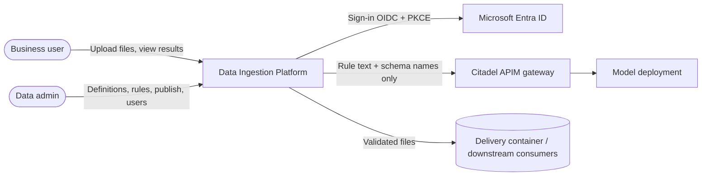
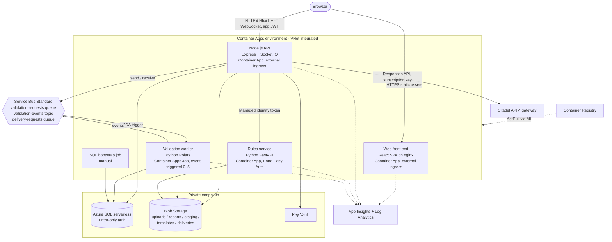
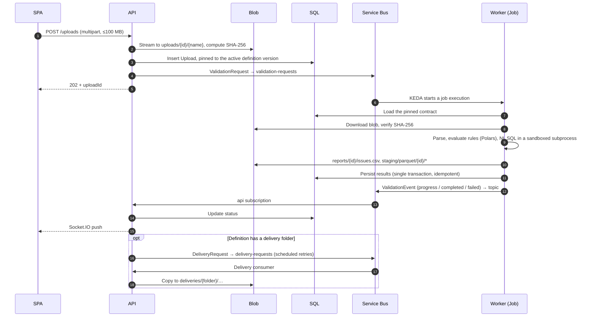
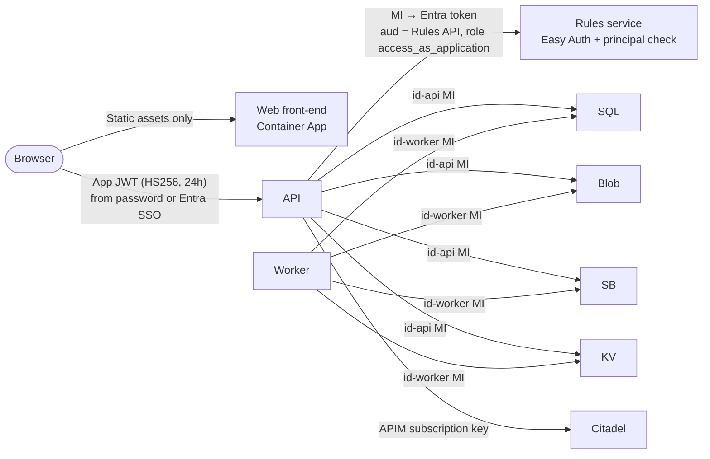

# Data Ingestion Platform: Architecture Overview

**For:** customer technical and architecture stakeholders · **Status:** proof of concept, deployed for development; authenticated OPS-01 cloud acceptance pending. See the [PoC handover](poc-handover.md) for scope and limits. The target region is **France Central** (see [deployment.md](deployment.md)).

> **Hosting:** the web front end runs on **Azure Container Apps** rather than Azure Static Web Apps, which isn't offered in France Central. Container Apps puts every tier on one platform.

## 1. Summary

Business users upload CSV, TSV, TXT and Excel files against a governed **file definition**. A definition contains versioned tables, columns and rules. Each file is validated asynchronously by a Python/Polars engine. Users receive per-rule results and an issues report. If the definition requests it, the file is then delivered to a downstream location. Admins can write rules in plain language. A model behind Citadel's Azure API Management gateway turns the text into a declarative rule or restricted SQL. Every proposal is validated and tested before it is saved, and it applies to uploads only after an admin publishes it.

**Recommended approach:** an Azure-native, event-driven design. A stateless web/API tier is decoupled through Service Bus from scale-to-zero validation workers. Data-plane access uses managed identities, and data services sit behind private endpoints.

## 2. Context



## 3. Logical architecture (Azure target)



| Component | Technology | Responsibility |
|---|---|---|
| Front-End | React 19 + Vite 7 on unprivileged nginx (port 8080), in a Container App that scales 0–2 | User and admin UI, live status over Socket.IO. A stateless static container; the API URL is injected when the container starts |
| API (`Back-End`) | Node 24, Express, TypeScript | Authentication and RBAC, definitions, versioning and audit, upload intake, orchestration, delivery, NL rule authoring |
| Rules service (`Validation-Service`) | Python 3.12, FastAPI | Synchronous rule compile/test, contract validation, dry run, example-file analysis |
| Validation worker (same image) | Python, Polars, PyArrow, sqlglot | Parses files, evaluates rules, writes reports and Parquet, persists results |
| Contracts (`contracts/`) | JSON Schema | Single source for RuleConfig, the definition contract and message schemas. TypeScript declarations are generated from it (CI fails when they are stale); the Pydantic models are hand-written and checked against the schemas and examples by tests |
| Data | Azure SQL, Blob Storage | Metadata and results (SQL); files and artifacts (Blob) |
| Messaging | Service Bus | Decouples intake, validation and delivery; provides retries and dead-lettering |

## 4. Key flows

### 4.1 Upload → validate → deliver



**Upload states:** `UPLOADED → VALIDATION_QUEUED → VALIDATION_IN_PROGRESS → VALIDATION_PASSED | VALIDATION_FAILED`. A passed upload then becomes `VALIDATED` (no delivery) or moves `DELIVERY_QUEUED → DELIVERY_IN_PROGRESS → DELIVERED | DELIVERY_FAILED`. Transitions use compare-and-set in SQL, so duplicate or out-of-order events are ignored.

### 4.2 Natural-language rule authoring

```mermaid
sequenceDiagram
    participant Ad as Admin
    participant A as API
    participant F as Model via Citadel APIM
    participant R as Rules service
    Ad->>A: "Amount must be ≤ credit limit" + the workspace's unsaved structure and rules
    A->>F: Prompt + draft column, type and sheet names (no file data)
    F-->>A: Mapped RuleConfig, NL SQL + examples, or Rejected
    A->>R: /v1/rules/validate + /v1/rules/test (sqlguard, run examples)
    alt invalid
        A->>F: One correction attempt (max 3 model calls in total)
    end
    A-->>Ad: Streamed activity (NDJSON). Proposal only; nothing is saved
    Ad->>A: Add to the workspace draft → Save definition (rules + structure, one transaction)
    Ad->>A: Review → Publish version N (audited)
```

**Guardrails:**
- The model output must be a schema-valid RuleConfig. It is never executed as code.
- `sqlguard` parses the SQL with sqlglot and checks it against allow-lists. Only declared columns and approved functions are permitted. Files, DDL/DML and non-deterministic functions are blocked.
- SQL runs in a spawned subprocess with a 30-second timeout.
- The review is stateless: the workspace sends its unsaved structure and rules, the server rebuilds the contract (lookups are loaded from the database, never taken from the client) and returns a proposed RuleConfig. Rules reach the database only through `PUT /admin/file-definitions/:id` (or creation), which validates the whole draft first and replaces the rule set in one transaction guarded by a revision token (409 when someone else changed the draft).
- An admin must publish a rule before it applies to uploads.
- Single-rule validation and example testing check the candidate against the definition's schema and
  lookups independently of other draft rules. Invalid existing rules do not block creating, editing,
  or regenerating a candidate; full publication validation still rejects them. No existing rule is
  automatically changed or removed.
- Authoring failures explain the reason and next action, alongside safe validation paths or failing
  example indices, in streamed activity and final rejection messages. Known SQL/reference failures,
  example expectation mismatches, and rules-service availability/authentication errors receive specific
  guidance. Invalid definition/existing-rule failures stop without a model correction. Final validation
  rejections include a response reference; unknown raw errors are withheld rather than echoed or guessed.
  Backend `[NATURAL_LANGUAGE_RULE_VALIDATION]` warnings correlate response ID, attempt, phase, and safe
  explanations without logging raw rule/schema payloads or example values.

## 5. Data architecture

| Store | Content | Notes |
|---|---|---|
| SQL `FileDefinitions`, `FileDefinitionVersions`, `Rules` | Draft and immutable published contracts, with rules as JSON | Each upload is pinned to a version, so results are reproducible |
| SQL `Uploads`, `UploadSheets`, `ValidationResults`, `ValidationRuleDetails`, `DeliveryRecords` | Status, counts, ≤100 sample issues per rule | Cell values are stored only in samples |
| SQL `Users`, `FileDefinitionUserAccess`, `UploadAccess`, `AuditLogs` | RBAC and the audit trail | Publish and admin actions are audited |
| Blob `uploads` | Raw customer files | Private; access via MI only |
| Blob `reports`, `staging` | issues.csv; Parquet (zstd) per table | `staging` is deleted after 30 days by a lifecycle rule |
| Blob `deliveries` | Delivered outputs | Deterministic names make replays idempotent; 7-day soft delete |

## 6. Security and identity



- **Identity:**
  - Separate user-assigned identities for the API, the worker and the SQL bootstrap job.
  - The front end has its own identity with `AcrPull` only. It holds no secrets and has no access to application data.
  - RBAC is scoped to individual Blob containers and Service Bus entities.
  - SQL uses Entra-only authentication with contained users (`db_datareader`/`db_datawriter`).
  - Service Bus local/SAS authentication is disabled, and the ACR admin user is disabled.
- **Secrets:** The JWT signing key, SSO client secret, Citadel APIM subscription key and App Insights connection string are stored in Key Vault and read by Container Apps through MI. There are no data-service connection strings in Azure. Local `.env` files are git-ignored.
- **User authentication:**
  - Entra SSO uses the authorization code flow with PKCE and server-side ID token validation. App-local password login is also supported.
  - The API then issues its own JWT. Roles are `admin` and `user`, with per-definition access grants.
  - Socket.IO uses the same token and is filtered per upload.
- **Input hardening:**
  - Extension and MIME allow-list, 100 MB size cap, sanitized file names and path-traversal guards.
  - SHA-256 integrity check between intake and validation.
  - Helmet, CORS allow-list, rate limiting, and an optional token-protected `/metrics` endpoint.
- **AI data handling:**
  - Only the rule text and schema names are sent through Citadel, never file contents.
  - Full model output is logged only when debug logging is explicitly enabled.
  - The backend calls `<CITADEL_ENDPOINT>/responses` (the customer's Citadel APIM gateway) using an APIM subscription key from Key Vault (ignored `.env` locally). No key reaches the browser; APIM handles downstream model authentication.

## 7. Networking

| Resource | Exposure | Rationale |
|---|---|---|
| SQL, Blob, Key Vault | **Private endpoint only**; public access disabled | Customer data plane |
| API, web front-end Container App | Public HTTPS (Container Apps external ingress, managed TLS, HTTP disallowed) | User-facing. API CORS allows only the exact front-end origin, and the Entra callback is `<frontend>/auth/callback` |
| Rules service | Public FQDN, **Easy Auth enforced** (401 for anonymous callers; only the API MI is allowed) | Documented, owner-accepted deviation from internal ingress |
| Service Bus (Standard) | Public endpoint; Entra-only authentication and RBAC, without an IP allowlist | Standard supports IP filtering but not Private Link/service endpoints; the Consumption Container Apps environment has no reported outbound IP list. The owner chose this lower-cost network posture instead of adding NAT Gateway costs. |
| ACR (Basic), App Insights | Public, authenticated | Private Link needs a higher tier |

## 8. Reliability, scale and performance

- **Async decoupling:** Service Bus provides at-least-once delivery, lock renewal and dead-lettering of malformed requests. Worker writes are idempotent per upload.
- **Elastic validation:** KEDA scales the worker job from 0 to 5 parallel executions (2 vCPU / 4 GiB each, configurable), with a 30-minute timeout and 2 retries.
- **Measured engine performance** (dev host, not the reference 4 vCPU / 8 GiB gate):

  | Workload | Time | Peak memory |
  |---|---|---|
  | 1M-row CSV, 18 rules | ~1.2 s | ~1.1 GiB |
  | 300k-row XLSX | ~2.5 s | — |

  An NL SQL row rule adds about 17 ms. A golden suite over the 109 sample upload files regression-tests the engine's outcomes.
- **Current constraints:** the API and rules service are each pinned to **1 replica**, because Socket.IO and the delivery consumer run in-process. There is no zone redundancy (Storage LRS, single-zone SQL), and no multi-region DR.

## 9. Observability and operations

- **Telemetry:** Azure Monitor OpenTelemetry instruments the Node API, Python rules API, and validation worker with separate service roles; the worker exports validation-stage spans (download, parse, rules, write, persist) and a rows/sec metric with bounded exporter flushing before job exit. The React browser uses the Application Insights JavaScript SDK through public runtime routing configuration. Exported telemetry excludes raw query strings and application payloads. Container console/system logs remain a separate Log Analytics pipeline with 30-day workspace retention. Prometheus metrics are still exposed by the API. See [telemetry configuration and verification](deployment.md#application-insights-telemetry).
- **Queue health:** queue depth and dead-letter counts are shown on the admin Monitoring page.
- **Logging policy:** no cell values, file contents, tokens or secrets in logs.
- **CI** (GitHub Actions on every PR and push to main): zero-warning lint, type-check, unit tests and build for all three components, a production dependency audit (high or critical advisories fail; Dependabot raises weekly update PRs), a check that the generated TypeScript contracts are up to date, and compilation of the Bicep templates and parameter file. The Playwright end-to-end suite and the sample corpus need the full local stack and are run manually before a release (see the [README](../README.md#testing)).
- **CD:**
  - A manual workflow uses OIDC and a protected GitHub environment. It supports targeted frontend and validation-worker image deployments, plus an all-services `azd deploy`; provisioning is a separate step that requires approval.
  - Images for the web front end, the API and the rules service/worker are built remotely in ACR with immutable tags.
  - The web image has no hard-coded API URL. At start, it writes `runtime-config.js` from `API_URL`, which must be HTTPS and end in `/api/v1`. One image can therefore be promoted across environments. The postprovision hook sets the API CORS origin and the SSO callback to the front-end URL.
  - Schema migrations run as an in-VNet job. The job temporarily elevates the bootstrap MI and always restores the SQL admin.
- **Local development:** run `start.ps1` with Docker Compose (SQL Server, Azurite, Service Bus emulator). No Azure dependency except Citadel for NL rules.

## 10. Cost drivers

There is no fixed estimate yet. It depends on active hours and data volumes.

- **Always-on:** API replica, rules-service replica, three private endpoints, Service Bus Standard.
- **Web front end:** 0.25 vCPU / 0.5 GiB per replica, scaling from 0 to 2 replicas. It costs almost nothing when idle; the trade-off is a cold start for the first user. Set the minimum to 1 replica in production if latency matters.
- **Usage-based:**
  - Worker vCPU-seconds.
  - SQL serverless: 0.5–2 vCores, auto-pauses after 60 minutes.
  - Log Analytics ingestion.
  - Model tokens through Citadel: 1–3 calls per NL rule authoring session; none at upload time. Existing APIM gateway charges also apply.

## 11. Key decisions

| # | Decision | Alternatives considered | Rationale |
|---|---|---|---|
| D1 | Python + Polars engine replacing Node validation | Keep Node; Spark/Fabric; DuckDB | ~1M rows/s on one node, columnar, no cluster cost; regression-tested by the sample-corpus golden suite. Evidence in "Evidence for D1" below |
| D2 | Container Apps Jobs (event-triggered) for workers | Functions, AKS, always-on worker | Scale to zero, long runs (30 min), large memory, KEDA built in |
| D3 | Service Bus queues/topic between API and worker | Direct HTTP, Storage queues | Retries, DLQ, scheduled delivery retries, topic fan-out |
| D4 | Contract-first JSON Schema shared across TS/Python | Hand-maintained types | Prevents drift across language boundaries |
| D5 | Versioned definitions, uploads pinned to a version | Mutable definitions | Reproducibility, auditability, safe rule changes |
| D6 | LLM output limited to declarative RuleConfig or guarded SQL | LLM-generated code | Removes code-execution and prompt-injection blast radius; deterministic runtime |
| D7 | Standard tiers (Service Bus, ACR) with Entra-only public access rather than Premium + Private Link | Premium everywhere | Lower PoC recurring cost; Service Bus has broader network reach, with Entra authentication and RBAC still enforced |
| D8 | Host the web front end on Azure Container Apps | Static Web Apps (not offered in France Central), App Service, Blob static website + Front Door | Static Web Apps isn't offered in France Central. Container Apps shares the platform, identity model, ACR, logging and `azd` pipeline with the other services, has an SLA (SWA Free has none), and allows a future same-origin proxy or private ingress. Trade-offs: no built-in global CDN, and the team must patch the nginx image |

## 12. Risks, gaps and recommendations

| Severity | Item | Recommendation (production) |
|---|---|---|
| High | API is a single replica, with Socket.IO and the delivery consumer in-process (SPOF; no horizontal scale) | Move real-time updates to **Azure Web PubSub**, split the delivery consumer into a Container Apps Job, and allow ≥2 replicas |
| High | App JWT is stored in `localStorage` (XSS exposure), uses an HS256 shared secret, lasts 24h, and cannot be revoked | Use httpOnly SameSite cookies with CSRF protection, shorter tokens with refresh, and a revocation list. Prefer Entra-only sign-in and retire local passwords |
| High | No malware scanning of uploaded files (including macro-enabled Excel types) | Enable **Defender for Storage** malware scanning on `uploads` and gate validation on a clean result |
| Medium | Rules service has a public FQDN (authenticated) | Use internal ingress with in-app bearer validation if policy requires it |
| Medium | Service Bus has a public endpoint without an IP allowlist; local/SAS authentication is disabled | If network-level restriction is required, add NAT Gateway plus a static egress IP and IP rules, or upgrade Service Bus to Premium and use Private Link; review the additional recurring cost |
| Medium | No zone redundancy or DR | ZRS/GRS storage, zone-redundant SQL, a zone-redundant Container Apps environment, and documented RPO/RTO |
| Medium | The front end sends only `nosniff` and `Referrer-Policy` headers. There is no Content-Security-Policy, frame protection or HSTS, which matters more while the token is in `localStorage` | Add CSP (`default-src 'self'`, `connect-src` limited to the API origin), `frame-ancestors 'none'` and HSTS in `nginx.conf` |
| Low | The front end's runtime config, CORS, SSO callback and cold start were checked only with unauthenticated requests | Run the post-deployment checks in [deployment.md](deployment.md) with a signed-in test user after each new environment is deployed |
| Low | No CDN or WAF in front of the public front end and API | Add Azure Front Door with WAF if users are spread across regions or policy requires a WAF |
| Medium | Performance figures come from a dev host only | Re-run `dq-engine bench` on the 4 vCPU / 8 GiB reference before go-live; load-test intake |
| Medium | Regional capacity isn't guaranteed: provisioning in other regions during development failed for lack of Azure SQL and Container Apps capacity, and quota or provider metadata does not guarantee capacity | Run `azd provision --preview` in the target region and get approval before provisioning. In the original development subscription, soft-deleted Key Vaults remain in the earlier regions; they do not affect a new subscription |
| Low | No retention policy for `uploads`/`reports`, and `deliveries` has no expiry | Define data retention and deletion aligned with the customer's data-handling policy |
| Low | NL rules: example tests reduce but do not prove semantic equivalence | Keep human review and publish approval; add an evaluation set for the authoring prompt |

## Evidence for D1: engine selection

Measured on one machine (8 cores, 32 GB) with a 1M-row, 104 MB CSV and 18 rules, and a 300k-row, 52 MB `.xlsx`; every engine produced identical failure counts.

| Workload | Engine | Time | Peak memory |
|---|---|---:|---:|
| CSV, 1M rows, 18 rules | Former Node engine (row by row) | 14.0 s | 235 MB |
| | DuckDB from Node.js | 1.26 s | 544 MB |
| | **Polars from Python** | **0.55 s** | 400 MB |
| `.xlsx`, 300k rows, read only | SheetJS (former) | 8.4 s | 989 MB |
| | openpyxl (read-only) | 10.4 s | 67 MB |
| | DuckDB `read_xlsx` | 1.9 s | 131 MB |
| | **calamine via `fastexcel`** | **1.3 s** | 336 MB |

Why Polars and calamine: columnar engines are 10–25× faster than row loops in any language; the JSON rules compile to engine expressions (no SQL pasted from
user input); Excel reading is the bottleneck and calamine is the fastest reader measured and also reads legacy `.xls`, which DuckDB cannot. Options not chosen:
Spark/Fabric (job start-up dominates for files of 100 MB or less; keep as an option for multi-GB backfills), loading into Azure SQL then running SQL rules (the load
costs more than the checks and competes with the operational database), DuckDB as the core (within 2× of Polars but needs generated SQL text, a slower Excel reader
and no `.xls`), and .NET/Go row-by-row engines (faster than Node but still row-oriented). Python gives about 90% of Rust's speed with much faster development; the
worker and API boundary is only the queue and the JSON rule format, so the engine could be replaced without changing the UI or API.

## 13. Decisions for the customer

1. Approve the target architecture (D1–D8) for pilot deployment, including the Container Apps front end.
2. Accept the PoC deviations: public authenticated rules-service endpoint and Standard tiers without Private Link. Alternatively, mandate Premium networking before the pilot.
3. Confirm whether the **High** items are pilot-blocking or production-blocking.
4. Approve the target region (data residency and service availability; France Central is the documented target) and the provisioning budget.
5. Supply the model gateway, Entra registrations, deployment identity and first administrator listed in the [PoC handover](poc-handover.md#what-the-customer-must-supply-or-replace).
